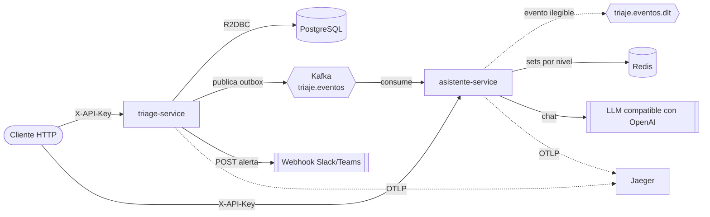

# VidaCruz - Triaje digital

Dos microservicios reactivos (Spring WebFlux) para las salas de urgencias de un grupo de salud. `triage-service` registra pacientes, calcula su nivel de triaje con las reglas del enunciado, controla el SLA de espera, escala los pacientes vencidos y avisa al equipo médico. `asistente-service` responde preguntas sobre protocolos clínicos con RAG, solo con lo que dice el corpus, y mantiene en Redis el conteo de pacientes activos por nivel a partir de los eventos de Kafka.

## Ejecución local

Requisitos: Docker con Compose v2. Para correr los tests y compilar fuera de Docker, además JDK 21 y Maven.

```bash
docker compose up -d --build
```

Levanta PostgreSQL, Kafka (con los topics `triaje.eventos` y `triaje.eventos.dlt`), Redis, un receptor de webhooks de demo, Jaeger y los dos servicios. La primera vez tarda por la construcción de las imágenes.

### Variables opcionales (`.env`)

Todo funciona sin `.env`. Si quieres cambiar algo, copia `.env.example` a `.env`. La más importante es `LLM_API_KEY` (clave de un proveedor compatible con la API de OpenAI; `LLM_BASE_URL` y `LLM_MODEL` permiten cambiar de proveedor).

Sin `LLM_API_KEY` el asistente arranca en modo degradado: las consultas que sí tienen protocolo responden 503 con `Retry-After`, y las que no tienen protocolo responden el aviso "No existe un protocolo disponible para esta pregunta." sin necesidad del LLM. El endpoint de estado de urgencias no se ve afectado.

### Puertos y URLs

| Componente | URL en el host | Notas |
|---|---|---|
| triage-service | http://localhost:8081 | Swagger: http://localhost:8081/swagger-ui.html |
| asistente-service | http://localhost:8082 | Swagger: http://localhost:8082/swagger-ui.html |
| Jaeger (trazas) | http://localhost:16686 | OTLP HTTP en 4318 |
| Webhook echo | http://localhost:8083 | Ver sus logs: `docker compose logs -f webhook-echo` |
| PostgreSQL | localhost:5435 | base `triage`, usuario `triage` |
| Kafka | localhost:9094 | listener externo |
| Redis | localhost:6381 | |

Claves por defecto en local: `triage-local-key` y `asistente-local-key` (cabecera `X-API-Key`).

### Ejemplos

```bash
TRIAGE=http://localhost:8081/triage
ASIST=http://localhost:8082/asistente
TK="X-API-Key: triage-local-key"
AK="X-API-Key: asistente-local-key"

# Registrar un paciente (devuelve 201, Location, id, nivel y SLA)
curl -i -X POST $TRIAGE/pacientes -H "$TK" -H "Content-Type: application/json" -d '{
  "nombreCompleto":"Maria Perez","edad":58,"frecuenciaCardiaca":135,"presionSistolica":120,
  "presionDiastolica":80,"spo2":96,"temperatura":36.8,"dolor":4,"gcs":15,
  "quejaPrincipal":"palpitaciones"}'

ID=<id devuelto>

# Cambiar estado (REGISTRADO -> EN_CONSULTA -> ALTA)
curl -X PATCH $TRIAGE/pacientes/$ID/estado -H "$TK" -H "Content-Type: application/json" -d '{"estado":"EN_CONSULTA"}'

# Consultar paciente y su auditoría
curl $TRIAGE/pacientes/$ID -H "$TK"
curl $TRIAGE/pacientes/$ID/auditoria -H "$TK"

# Reporte de operación por hora (UTC, rango semiabierto, máximo 31 días)
curl "$TRIAGE/reportes/operacion?desde=2026-11-05T00:00:00Z&hasta=2026-11-06T00:00:00Z" -H "$TK"

# Alertas de escalamiento (filtro opcional: PENDIENTE, ENVIADA, FALLIDA)
curl "$TRIAGE/alertas?estado=ENVIADA" -H "$TK"

# Asistente: consulta con protocolo y consulta sin protocolo
curl -X POST $ASIST/consulta -H "$AK" -H "Content-Type: application/json" \
  -d '{"pregunta":"¿Cuáles son las contraindicaciones del protocolo de crisis hipertensiva?"}'
curl -X POST $ASIST/consulta -H "$AK" -H "Content-Type: application/json" \
  -d '{"pregunta":"¿Cuál es la capital de Francia?"}'

# Pacientes activos por nivel (leído de Redis)
curl $ASIST/estado-urgencias -H "$AK"
```

### Ver el escalamiento rápido

El SLA de un paciente crítico es de 5 minutos y el monitor revisa cada 15 segundos. Para verlo en una demo, baja ambos valores:

```bash
TRIAGE_SLA_CRITICO_MINUTOS=1 TRIAGE_JOBS_SLA_INTERVALO_MS=2000 docker compose up -d --build triage-service
```

Registra un paciente crítico (por ejemplo `spo2` 85), espera un minuto sin cambiarle el estado y consulta `GET /triage/pacientes/{id}` (`escalado: true`), `GET /triage/alertas` y los logs de `webhook-echo`. La alerta también aparece en la auditoría del paciente como `paciente_escalado`.

### Tests

```bash
cd triage-service && mvn verify
cd asistente-service && mvn verify
```

Requieren Docker en marcha: los tests de integración usan Testcontainers (PostgreSQL, Kafka y Redis). Incluyen BlockHound sobre el flujo HTTP completo para detectar llamadas bloqueantes.

## Arquitectura



Los servicios no comparten librerías: el contrato entre ellos es el JSON del evento.

**triage-service** (por capas, sin lógica en los controladores):
- `controller`: HTTP y OpenAPI. `validators`: reglas de rangos que acumulan todos los errores del request.
- `service`: casos de uso. `TriageClassifier` es puro y sin I/O; registrar, cambiar estado y escalar escriben dato, auditoría y outbox en una sola transacción.
- `repository`: R2DBC (`R2dbcEntityTemplate` y `DatabaseClient` para el SQL del reporte y los UPDATE condicionales). Flyway migra por JDBC solo al arrancar.
- `job`: monitor de SLA, publicador del outbox y despachador de alertas, todos sobre una clase base que evita corridas solapadas.
- `exception` y `config`: formato de error común, filtros de API key y correlación, Kafka, OpenAPI.

**asistente-service** (sin base de datos):
- `controller`, `validators`, `service`: consulta RAG (`RagRetriever`, `CompuertaRelevancia`, `PromptBuilder`, `LlmGateway`, `RespuestaValidator`) y estado de urgencias.
- `consumer`: `UrgenciasEventConsumer` lee `triaje.eventos`, proyecta a Redis y manda a la DLT lo ilegible.
- `repository`: acceso reactivo a Redis. `config`: LLM, RAG, Resilience4j, Kafka, filtros.

## Tecnologías

| Tecnología | Versión |
|---|---|
| Java | 21 |
| Spring Boot (WebFlux, Data R2DBC, Actuator, Validation) | 3.5.16 |
| reactor-kafka | la del BOM de Spring Boot 3.5.16 |
| PostgreSQL / Redis / Kafka (imágenes) | 16-alpine / 7-alpine / apache/kafka 3.8.0 |
| Flyway | el del BOM de Spring Boot |
| LangChain4j (BOM; `langchain4j-open-ai`, `embeddings-all-minilm-l6-v2-q`) | 1.23.0 |
| ONNX Runtime | 1.20.0 |
| Resilience4j | 2.4.0 |
| MapStruct / lombok-mapstruct-binding | 1.6.3 / 0.2.0 |
| springdoc-openapi (webflux-ui) | 2.8.17 |
| Micrometer Tracing (puente OpenTelemetry) y exportador OTLP | los del BOM de Spring Boot |
| Testcontainers (asistente-service) | 2.0.5 |
| BlockHound | 1.0.18.RELEASE |
| JaCoCo | 0.8.13 |

## Decisiones clave

| Decisión | Por qué | ADR |
|---|---|---|
| Dos servicios, sin librería compartida; alertas dentro de triage | Cada servicio evoluciona solo; el contrato es el evento. Las alertas dependen de datos y transacciones de triage | [0001](docs/adr/0001-descomposicion-en-dos-servicios.md) |
| Outbox transaccional y Kafka con clave `pacienteId` | Nunca se pierde un evento ni se publica uno que no se confirmó; orden por paciente | [0002](docs/adr/0002-outbox-transaccional-y-kafka.md) |
| RAG con embeddings locales y barreras anti-alucinación en capas | Una respuesta clínica sin respaldo es peor que ninguna | [0003](docs/adr/0003-rag-y-barreras-anti-alucinacion.md) |
| Modo degradado del LLM | Si el proveedor cae, el servicio sigue vivo y responde 503 claro | [0004](docs/adr/0004-modo-degradado-y-resiliencia-llm.md) |
| Alertas por webhook persistidas y con reintentos | Funciona con Slack y Teams, sobrevive a caídas y no filtra datos personales | [0005](docs/adr/0005-alertas-rf06-webhook.md) |
| API key por servicio, fail-closed | Mínimo suficiente para esta fase, con ruta clara a Entra ID | [0006](docs/adr/0006-autenticacion-api-key.md) |
| AKS de dos nodos pequeños con datos en el clúster | Costo; el equivalente administrado está documentado | [0007](docs/adr/0007-despliegue-en-azure.md) |

## Contrato del evento Kafka

Topic `triaje.eventos` (3 particiones, retención infinita para poder reconstruir Redis). Mensaje JSON, clave = `pacienteId` (orden por paciente):

```json
{
  "eventoId": "0b7c1f6e-2f1d-4c55-8d0a-6f3f2b9d7a10",
  "tipo": "paciente_registrado",
  "version": 1,
  "pacienteId": "3f2b8c1e-5d4a-4e7b-9a10-2c6d8e9f0a1b",
  "nivel": "CRITICO",
  "estado": "REGISTRADO",
  "escalado": false,
  "slaMinutos": 5,
  "ocurridoEn": "2026-11-05T15:00:00Z",
  "correlationId": "9c1f4a52-7e0d-4b8a-a3c1-5d2e6f708192"
}
```

- Tipos: `paciente_registrado`, `paciente_en_consulta`, `paciente_alta`, `paciente_escalado`.
- Sin datos personales: ni nombre ni queja principal.
- Cabeceras: `tipo-evento`, `correlation-id` y `traceparent` (cuando la solicitud tenía traza).
- El consumidor ignora campos desconocidos (tolerant reader), así que se pueden agregar campos sin romperlo. Lo ilegible o de tipo desconocido va a `triaje.eventos.dlt`.
- Productor: `acks=all`, idempotente, `max.block.ms=5000`, `request.timeout.ms=5000`, `delivery.timeout.ms=10000`. Entrega al menos una vez; el consumidor es idempotente.

## RF-06: alertas de escalamiento

Cuando un paciente supera su SLA sin pasar a consulta, el monitor lo escala y, en la misma transacción, deja una alerta `PENDIENTE`. Un despachador la envía por webhook (formato con campo `text`, válido para Slack y para Teams con Workflows), reintenta con espera exponencial hasta 5 veces y la marca `ENVIADA` o `FALLIDA`. El estado se consulta en `GET /triage/alertas`. El mensaje no lleva nombre ni queja. Detalle en el [ADR 0005](docs/adr/0005-alertas-rf06-webhook.md).

## Supuestos y limitaciones

- La queja administrativa (nivel `NO_URGENTE_2`) se reconoce por coincidencia exacta normalizada (minúsculas, sin tildes, espacios colapsados) contra la lista del enunciado. "Seguimiento de infarto" no baja de prioridad; ante la duda, queda en el nivel con SLA menor. La contrapartida es que variantes legítimas ("renovar recetario") no se reconocen.
- La hora del reporte por hora se calcula en UTC, no en hora local de la clínica.
- El modelo no tiene sede ni sala: hay un solo canal de guardia para todas las alertas, y quién reconoce la alerta queda fuera de alcance.
- Kafka, PostgreSQL y Redis corren dentro del clúster (y en compose) por costo. En producción serían servicios administrados.
- `reactor-kafka` está descontinuado (Spring lo anunció en 2025). Se usa por su manejo de backpressure; la salida está en el [ADR 0002](docs/adr/0002-outbox-transaccional-y-kafka.md).
- El modelo de embeddings (all-MiniLM-L6-v2) es sobre todo en inglés y separa mal las preguntas ajenas al corpus en español. Se compensa con la compuerta léxica del [ADR 0003](docs/adr/0003-rag-y-barreras-anti-alucinacion.md); no es una garantía matemática y el corpus es de solo tres protocolos.
- Si Redis se vacía con el servicio corriendo, el conteo queda incompleto hasta reiniciar `asistente-service`: al arrancar, cada partición sin su marca `urgencias:inicializado:<particion>` se relee desde el inicio, y la marca solo se crea al alcanzar el final que había al asignarse. Si el servicio cae a mitad, al volver relee otra vez esa partición, lo que no cambia el resultado porque las operaciones son idempotentes.
- El publicador del outbox lo ejecuta una sola réplica a la vez (advisory lock); más réplicas de triage dan disponibilidad, no más caudal de publicación.
- Hay una sola API key por servicio, sin roles ni usuarios.

## Despliegue en Azure

`infra/azure/main.bicep` crea el ACR y un AKS de dos nodos con app routing; `k8s/` tiene los manifiestos (kustomize).

```bash
export DB_PASSWORD=... TRIAGE_API_KEY=... ASISTENTE_API_KEY=...   # opcional: LLM_API_KEY, LLM_BASE_URL, LLM_MODEL, WEBHOOK_ALERTAS_URL
# opcional: NODE_VM_SIZE, NODE_COUNT y CONSTRUCCION=local (docker build y push, para suscripciones sin ACR Tasks)
az login
./infra/azure/deploy.sh      # grupo de recursos, ACR, AKS, build de imágenes, secret y manifiestos
./infra/azure/destroy.sh     # borra el grupo de recursos
```

`deploy.sh` imprime al final las URLs de Swagger detrás del ingress (`/triage/swagger-ui.html` y `/asistente/swagger-ui.html`). Detalle y alternativas en el [ADR 0007](docs/adr/0007-despliegue-en-azure.md).

### URL pública

Desplegado en AKS (East US), detrás del ingress:

| Servicio | Swagger | API |
| --- | --- | --- |
| Triage | http://20.232.247.231/triage/swagger-ui.html | `http://20.232.247.231/triage/...` |
| Asistente | http://20.232.247.231/asistente/swagger-ui.html | `http://20.232.247.231/asistente/...` |

Las API keys del despliegue se entregan por correo, no van en el repositorio. Swagger no pide clave; para probar desde él, usa **Authorize** con la clave de cada servicio. El asistente usa `gpt-4.1-mini` en Azure AI Foundry.

## Observabilidad

- Probes: `/actuator/health/liveness` y `/actuator/health/readiness`, públicos. La readiness de triage incluye R2DBC; la de asistente no depende del LLM (el circuit breaker `llm` aparece en `/actuator/health` pero no la tumba).
- Métricas en `/actuator/prometheus` (requiere API key):
  - triage: `triage.clasificacion{nivel}`, `triage.escalamientos{nivel}`, `triage.alertas{resultado}`, `triage.outbox.pendientes` (gauge), `triage.outbox.descartados`.
  - asistente: `asistente.respuestas{tipo=con_fuentes|sin_protocolo|invalida}`, `asistente.llm.latencia{resultado=ok|error|circuito_abierto}`, `asistente.eventos{tipo}`, más las del circuit breaker de Resilience4j.
- Logs: legibles en local; JSON en formato ECS en el despliegue (`logging.structured.format.console=ecs`). Cada línea lleva `correlationId`. El `X-Correlation-Id` del cliente se acepta si cumple `^[A-Za-z0-9-]{8,64}$`; si no, se genera un UUID. Se devuelve en la respuesta y viaja en el evento (`correlationId` y cabecera `correlation-id`).
- Trazas: OpenTelemetry por OTLP hacia Jaeger, activadas con `TRACING_ENABLED` (en compose vienen en `true`). El `traceparent` se guarda en el outbox y se pone como cabecera Kafka, de modo que el consumo en asistente queda en la misma traza.

## Seguridad

Cada servicio exige la cabecera `X-API-Key`. La comparación es en tiempo constante y, si la variable (`TRIAGE_API_KEY`, `ASISTENTE_API_KEY`) está vacía, el servicio no arranca. Son públicos solo `/actuator/health/**`, Swagger y los esquemas OpenAPI (para que los probes de Kubernetes funcionen); lo demás, incluido `/actuator/prometheus`, pide la clave. Sin clave o con una incorrecta responde 401 con el formato de error común.

Se eligió API key porque el enunciado no define usuarios ni roles y es lo mínimo que cierra el acceso sin montar un proveedor de identidad. La evolución natural es OAuth2 con Entra ID: validar JWT como resource server, con roles (por ejemplo enfermería, médico, consulta de protocolos) en lugar de una clave compartida. Ver [ADR 0006](docs/adr/0006-autenticacion-api-key.md).
